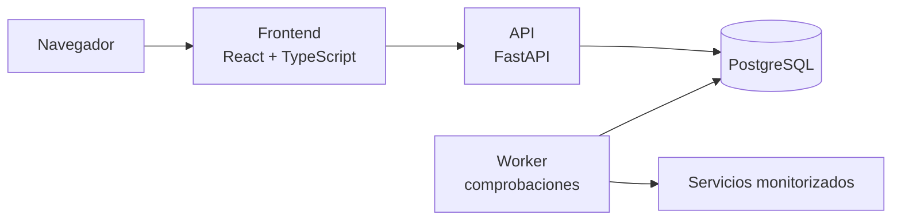

# PulseWatch

Monitorización de webs y APIs con gestión de incidencias.

PulseWatch comprueba cada cierto tiempo si tus servicios HTTP responden, guarda el historial de disponibilidad y tiempos de respuesta, y abre una incidencia cuando un servicio cae, que se cierra sola al recuperarse.

> **Estado: en diseño.** Por ahora el repositorio contiene la documentación de producto, arquitectura y seguridad. La aplicación todavía no está implementada y no hay demo pública. Todo lo que aparece abajo como "previsto" es el plan, no una función disponible.

## Qué permitirá hacer

- Registrar monitores HTTP con intervalo y timeout configurables dentro de unos límites.
- Ver el historial de comprobaciones y los tiempos de respuesta de cada servicio.
- Detectar caídas tras varios fallos consecutivos, sin abrir incidencias duplicadas.
- Registrar la recuperación con su fecha y duración.
- Gestionar usuarios, de modo que cada uno solo vea sus propios monitores.
- En fases posteriores: equipos, alertas por correo y webhook, y página pública de estado.

## Cómo está pensado

- **API y worker son procesos separados.** El servidor web nunca ejecuta el bucle de comprobaciones; lo hace un worker que lee los monitores pendientes, comprueba los destinos y guarda resultados e incidencias.
- **Un solo repositorio** con `frontend/` y `backend/`, sin microservicios en la primera versión.
- **Tiempos en UTC** y migraciones de base de datos versionadas.

Más detalle en [docs/architecture.md](docs/architecture.md).

## Seguridad

Un monitor consulta URLs que aporta el usuario, así que el servidor podría usarse para atacar redes internas. Por eso el diseño exige, desde el primer monitor:

- Solo HTTP/HTTPS, sin credenciales en la URL y con verificación TLS.
- Resolución y validación de IPv4 e IPv6, bloqueando loopback, redes privadas, link-local y servicios de metadatos, ligada a la dirección real de conexión.
- Redirecciones desactivadas, y timeout, tamaño, concurrencia e intervalos limitados.
- Autorización por recurso en el backend.

Los controles completos están en [docs/security.md](docs/security.md).

## Tecnologías

| Parte | Tecnología |
| --- | --- |
| Frontend | React, TypeScript y Vite |
| Backend | Python y FastAPI |
| Datos | PostgreSQL, SQLAlchemy y Alembic |
| Calidad | ESLint, Prettier, Ruff, mypy y TypeScript |
| Pruebas | Vitest, Testing Library, pytest y Playwright |
| Entorno | Docker y Docker Compose |
| Automatización | GitHub Actions y SonarQube Cloud |

Las versiones se fijarán, junto con sus archivos de bloqueo, al inicializar cada parte.

## Hoja de ruta

| Fase | Objetivo | Estado |
| --- | --- | --- |
| 0 | Definir producto, arquitectura, seguridad y forma de trabajo | Completada al integrar la última PR |
| 1 | Base técnica: frontend, backend, base de datos, Docker, CI y análisis de calidad | Pendiente |
| 2 | Primer recorrido: crear un monitor y consultar sus resultados en local | Pendiente |
| 3 | Versión publicable: usuarios, incidencias, permisos y responsive | Pendiente |
| 4 | Despliegue y operación: CD, copias, logs y demo | Pendiente |
| 5 | Ampliaciones: equipos, alertas y estado público | Pendiente |

El detalle de cada fase está en [docs/roadmap.md](docs/roadmap.md).

## Documentación

- [Producto y alcance](docs/product.md)
- [Arquitectura](docs/architecture.md)
- [Seguridad](docs/security.md)
- [Calidad y pruebas](docs/quality.md)
- [Entorno y despliegue](docs/deployment.md)
- [Hoja de ruta](docs/roadmap.md)
- [Decisiones técnicas](docs/decisions/README.md)
- [Flujo de Git](docs/git-workflow.md)
- [Cambios](CHANGELOG.md)

## Autor

Manuel Casinos Pérez, desarrollador full stack junior en Valencia.

- [GitHub](https://github.com/Manuelklk03)
- [LinkedIn](https://www.linkedin.com/in/manuel-casinos-perez/)

## Licencia

Pendiente de elegir antes de publicar la primera versión.
